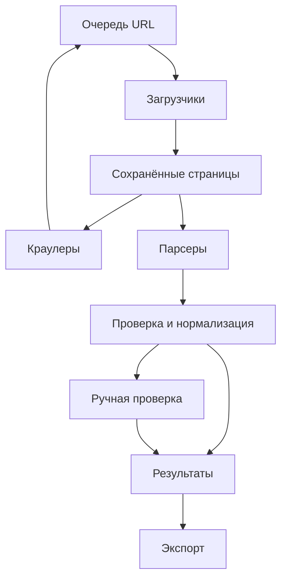

# Распределённая система универсального парсинга

Дата обновления: 2026-10-10 (Europe/Moscow).
Статус: рабочая структура требований и архитектуры. Решения от 10 октября 2026 года перенесены в требования.

## 1. Назначение

Система получает URL источника либо поисковую тему/запрос. В поисковом сценарии сначала обнаруживает источники через подключённые поисковые движки. Затем исследует HTML-сайты, строит план сбора, обходит страницы, сохраняет исходные материалы и независимо извлекает из них структурированные записи.

Координатор управляет этапами и подключёнными исполнителями. Первая версия работает на одной машине, с архитектурной возможностью подключения других машин позже. Первоначально используются обычные алгоритмы; LLM подключается как дополнительная возможность.

## 2. Подтверждённые требования пользователя

- Два режима настройки задания: обычный и с использованием LLM для формирования запроса/настроек. Граница роли LLM требует уточнения. Предыдущая интерпретация «парсинг URL против кроулинга» не соответствует уточнению пользователя.
- Возможность задать цель сбора естественным языком с использованием LLM.
- В первой версии источники — сайты и HTML. Другие форматы добавляются плагинами.
- Система исследует источник и предлагает пользователю варианты глубины и других параметров обхода.
- Сочетание обычных исполнителей и LLM-агентов; сначала обычные исполнители.
- Допускается остановка и участие пользователя при CAPTCHA или блокировке.
- Несколько краулеров и парсеров внутри одного задания; возможность запуска с одним исполнителем каждого типа.
- Краулер находит ссылки; страницы сохраняются; парсеры обрабатывают их независимо.
- Расширяемость плагинами. Способ установки и исполнения предложить по технической целесообразности.
- Результаты: JSON, таблицы, база данных, сохранённые материалы. Внешнее API выдачи результатов пока не требуется.
- Сохранять происхождение значений, выявлять дубликаты, отмечать пропуски и направлять спорные записи на ручную проверку.
- Пауза, отмена, продолжение после сбоя, расписание, повторные обходы и поиск изменений.
- Отображать общий прогресс, работу исполнителей, ошибки; при использовании LLM — затраты.
- Поддержка нескольких машин, разделение сущностей, подключение к координатору.
- Координатор строит пайплайн обработки и управляет выполнением.
- Предусмотреть исполнителей и плагины на разных языках программирования. Основной язык ядра ещё не выбран.
- Нужны оба интерфейса: веб-панель и командная строка.
- Перед основным сбором система ждёт подтверждения пользователя.
- Нужен визуальный выбор элементов по кликам на предварительно скачанной странице.
- Нужен визуальный редактор пайплайна: блоки, связи и параметры при нажатии на блок.
- В первой версии развёртывание на одной машине. Число параллельных запусков и объём сбора пока не определены.
- Проверочный сайт пока не выбран; это не препятствует проектированию архитектуры.
- Добавить возможность начинать с поисковой темы без URL, например «Станки»: поиск источников через подключаемые движки, в том числе возможность адаптера DuckDuckGo. Конкретный способ доступа к DuckDuckGo ещё не выбран.
- LLM в первой версии нет. Когда модель появится, она предлагает схему, правила и план. Извлечение значений со страниц остаётся правилами, а не вызовом модели.
- Первая версия обязана работать и на Windows, и на Linux.
- Клик по полю в одной карточке предлагает такие же поля в остальных карточках и показывает их на проверку. Молча на все карточки выбор не применяется.
- В списке может быть много заданий. Одновременно выполняется один сбор.
- Запрос «Станки» означает список сайтов и страниц по теме. Каталог товаров, цены и производители в эту цель не входят.

## 3. Предложенные решения, ещё не утверждённые пользователем

### 3.1. Режимы

Предложение после уточнения пользователя:
1. Визуальная/ручная настройка: URL, выбор полей по сохранённой странице, параметры и блоки пайплайна.
2. Настройка с LLM: URL и описание цели естественным языком; модель предлагает схему, правила и план; пользователь проверяет и подтверждает.

URL может быть задан пользователем либо получен на этапе поиска источников. Способ задания цели (визуально/через LLM), способ получения источников (URL/поиск) и охват (страница/список/обход) — независимые параметры.

LLM не обрабатывает страницы. Подтверждено 10 октября 2026 года: в первой версии модели нет. Позже модель только предлагает схему, правила и план. Извлечение значений остаётся правилами.

### 3.1.1. Поиск источников

Подтверждённый запрос на возможность: пользователь вводит тему, например «Станки», и система ищет источники через поисковые движки. Для «Станки» подтверждённый результат — список сайтов и страниц по теме. Каталог товаров, цены и список производителей этим запросом не задаются.

Предложенный процесс:
1. Получить тему и при необходимости уточнить цель, регион и язык.
2. Построить поисковые запросы: без LLM — исходный запрос/явные шаблоны, с LLM — предложенные уточнения и расширения.
3. Выполнить ограниченное число поисков через выбранные провайдеры, при необходимости параллельно.
4. Сохранить результаты с поисковым запросом, провайдером, временем, позицией, URL, заголовком и сниппетом.
5. Объединить результаты и убрать повторяющиеся URL; сохранить происхождение из всех провайдеров. Не удалять разные полезные страницы одного домена автоматически.
6. Предложить источники, ограниченно исследовать кандидатов и построить план.
7. Дождаться подтверждения источников, схемы и границ основного сбора.
8. Передать выбранные URL загрузчикам/краулерам.

В редактор добавить блок «Поиск источников» с провайдерами, запросом, языком/регионом, лимитами выдачи, времени и затрат. Результат поиска — кандидат в источник, а не гарантированно подходящая запись для конечного набора данных. Выдача не гарантирует обнаружение всех сайтов.

Блок поддерживает выбор одного или нескольких движков. Адаптеры возвращают общий формат. Ошибка одного провайдера не должна терять уже полученные результаты остальных; сбои и ограничения показываются пользователю.

Предложенный тип плагина: search_provider. Для движков с официальным поисковым API использовать его; другие способы подключения оценивать отдельно. DuckDuckGo Instant Answer API по опубликованной документации проекта не является API полной поисковой выдачи. Не считать его готовым решением обнаружения сайтов. Brave имеет официальный API веб-поиска и служит примером подходящего контракта, но провайдер по умолчанию пока не выбран.

### 3.2. Определение схемы и правил извлечения

Разделять:
- схему результата: поля, типы, обязательность, связи;
- правила извлечения: соответствие полей элементам конкретного источника.

Варианты получения схемы: ручной список полей, шаблон сущности, исследование страниц, предложение через LLM.

Предложенный процесс:
1. Ограниченное предварительное исследование страниц разных типов.
2. Предложение схемы и правил обхода.
3. Предпросмотр нескольких записей с источниками и пропусками.
4. Корректировка и обязательное подтверждение пользователем перед основным сбором.
5. Фиксация версий схемы и правил.
6. Основной сбор.

Без LLM исследование использует таблицы, повторяющиеся DOM-блоки, подписи полей, JSON-LD и другие встроенные структурированные данные. Произвольное понимание любой страницы не гарантируется. При неоднозначности нужны шаблон, плагин либо ручная настройка.

JSON Schema предложена как формат структурной валидации. Для неоднородных характеристик — поле attributes. Схема результата не гарантирует семантическую правильность извлечения.

### 3.2.1. Визуальная настройка по сохранённой странице

Подтверждённый сценарий: загрузить страницу, показать сохранённый снимок, дать пользователю нажимать на необходимые элементы и сопоставлять их полям.

Предложенные детали реализации:
- Для статического HTML сохранять содержимое, для JavaScript-страниц — также итоговый DOM после загрузки.
- Каждый выбранный элемент связывать с элементом исходного снимка, даже если представление предпросмотра изменено.
- Предпросмотр изолировать от интерфейса приложения; исходные скрипты страницы в селекторе элементов не запускать.
- Создавать кандидаты правил извлечения по кликам, показывать найденные значения и количество совпадений.
- Проверять правила на других сохранённых страницах, а не только на выбранном примере.
- Клик по полю в одной карточке предлагает такие же поля во всех повторяющихся карточках и показывает совпадения на проверку. Пока пользователь не подтвердил предложение, в правила попадает только выбранный элемент.
- Элементы навигации и пагинации задаются отдельно от полей карточки.
- Скриншот сам по себе недостаточен для выбора DOM-элементов; использовать DOM-снимок с визуальным представлением.

### 3.2.2. Визуальный пайплайн и CLI

Подтверждено: редактор из блоков, параметры по клику, веб-интерфейс и CLI.

Предложение: оба интерфейса используют одно описание задания и плана. Узел редактора описывает этап, а число экземпляров исполнителя — его параметр. Один блок парсинга не означает один процесс парсера.

Координатор проверяет совместимость входов/выходов, наличие необходимых плагинов и допустимость связей перед запуском. Сохранять версии планов. Изменение существенных параметров после подтверждения требует нового подтверждения; активный запуск остаётся привязан к своей версии.

### 3.3. Сервисы и роли

| Роль | Ответственность | Масштабирование |
|---|---|---|
| Координатор | План запуска, состояния этапов, пауза, отмена, повторы | Сначала один активный; отказоустойчивость отдельно |
| Поиск источников | Выполнение поисковых запросов через адаптеры движков, объединение результатов, кандидаты URL | По провайдерам/запросам |
| Исследователь сайта | Выборка страниц, типы страниц, навигация, пагинация, предложения настроек | Несколько экземпляров |
| Планировщик сбора | Схема, правила и план по форме, шаблону или LLM | По необходимости |
| Краулер | Извлечение ссылок из снимков, фильтрация, новые URL | Несколько экземпляров |
| HTTP-загрузчик | Загрузка HTML, сохранение снимков | Несколько экземпляров |
| Браузерный загрузчик | JavaScript, действия на странице, итоговый DOM | Отдельный ограниченный пул |
| Парсер | Извлечение записей из сохранённых страниц | Несколько экземпляров |
| Обработчик качества | Нормализация, проверки, дубликаты, спорные записи | По необходимости |
| Экспортёр | JSON, CSV, XLSX и подключаемые форматы | По необходимости |
| Сравнение запусков | Новые, изменившиеся и исчезнувшие записи | Позже |

Реестр сервисов, каталог плагинов, расписание и мониторинг первоначально могут быть модулями управляющего сервиса. Логическая роль не обязана соответствовать отдельному сервису при каждом развёртывании; контракты должны позволять разделение.

### 3.4. Движение данных

Координатор управляет планом, разрешениями этапов, лимитами и состоянием запуска. Задания по страницам создаются динамически; обход содержит цикл обнаружения ссылок. Парсинг начинается по мере появления сохранённых страниц.

### 3.5. Основные сущности

- JobDefinition: описание цели и настройки повторяемого задания.
- Run: отдельный запуск задания с закреплёнными версиями настроек.
- PipelinePlan: этапы, зависимости, условия переходов и ограничения.
- Task: отдельная операция и её состояние.
- Attempt: попытка выполнения операции, исполнитель, время, результат или ошибка.
- Worker: подключённый экземпляр сервиса, возможности, слоты, доступность.
- PageSnapshot: сохранённый HTML/DOM, URL, время, HTTP-статус, хеш.
- ExtractionSchema: версия схемы результата.
- ExtractionRules: версия правил извлечения.
- Record: извлечённая запись, статус проверок, идентичность сущности.
- Evidence: происхождение поля, снимок, исходный фрагмент, положение в HTML, метод извлечения.
- PluginVersion: тип расширения, версия, контракт, конфигурация, ресурсы.
- ExportArtifact: результат выгрузки и связанный запуск.
- SearchSpec: тема, запросы, провайдеры, язык/регион, ограничения.
- SearchResult: результат конкретного провайдера с происхождением и позицией.
- SourceCandidate: объединённый кандидат страницы/сайта, оценка соответствия и решение пользователя.

### 3.6. Параллельность и распределённое выполнение

- Число краулеров, загрузчиков, браузеров и парсеров регулируется отдельно.
- Одно задание поддерживает как одиночных, так и нескольких исполнителей.
- Заданий в списке может быть много. Одновременно выполняется один сбор. Общий лимит запросов к домену от этого не отменяется: он ограничивает единственный идущий сбор.
- Каждый сервис регистрирует возможности, версии плагинов и свободные слоты.
- Координатор назначает операции совместимым исполнителям.
- Лимиты домена общие для всех машин и запусков, обращающихся к нему.
- Ограничивать накопление страниц, когда парсинг отстаёт от загрузки.
- Обнаруживать потерю исполнителя по сигналам доступности и срокам выполнения операций.
- Состояния и результаты сохраняются независимо от памяти координатора.
- Повторное выполнение операции не создаёт дубли результата.
- Завершение обхода определяется с учётом очереди и выполняющихся операций, которые ещё могут обнаружить URL.

### 3.7. Плагины

Предложенные типы: search_provider, source, fetcher, extractor, normalizer, validator, exporter, document_processor, llm_provider.

Минимальное описание плагина: id, version, contract_version, capabilities, config_schema, input_types, output_types, resource_requirements и способ запуска.

Предложение для первой версии: установка с перезапуском соответствующего воркера, закрепление версий на запуск. Сторонние расширения исполняются отдельно от координатора.

Поддержка разных языков подтверждена. Предложение: общий версионированный протокол заданий, результатов, ошибок, возможностей и отмены; большие артефакты передаются по ссылкам/идентификаторам, а не внутри сообщения. Плагин может быть отдельным процессом или сервисом со стандартным адаптером. Конкретный транспорт ещё не выбран.

Для Python-пакетов entry points могут использоваться как внутренний механизм обнаружения, но не являются общим межъязыковым контрактом.

### 3.8. Качество и пользовательский контроль

- Проверять структуру отдельно от смысла и полноты данных.
- Сохранять исходное и нормализованное значение.
- Обозначать отсутствующие и неоднозначные поля.
- Спорные результаты хранить отдельно до решения пользователя.
- Правила идентичности и удаления дубликатов задаются для типа сущности.
- Не считать отсутствие записи доказательством удаления при неполном повторном обходе.
- До определения полного объёма показывать счётчики и оценку прогресса, а не гарантированный процент.
- Глубина не заменяет лимиты страниц, времени, объёма данных и затрат.

### 3.9. Технологии

После исследования ERGOMS предложено использовать существующий Django/DRF + Vue 3/Vite + Celery; PostgreSQL для состояния SCOUT, broker из конфигурации платформы (для параллельного выполнения предпочтителен общий Redis). Это адаптация к выбранному репозиторию. Ранее предложенный RabbitMQ не требуется добавлять в первую версию. Поддержка исполнителей на разных языках остаётся обязательной через отдельный контракт адаптеров. JSON Schema предложена для описания данных. Файлы доступны пользователю через media_api; сырые снимки и временные артефакты размещаются по правилам project_layout. Подтверждены веб-панель, CLI и одна машина в первой версии. Первая версия обязана работать на Windows и на Linux. Пул фоновых задач и браузерная загрузка не должны зависеть от одной системы.

## 4. Закрытые вопросы и что ещё не выбрано

Ответы 10 октября 2026 года:

1. LLM позже только предлагает схему, правила и план. Извлечение страниц моделью не входит в эту возможность. В первой версии LLM нет.
2. Первая версия работает на Windows и на Linux.
3. Похожие поля в повторяющихся карточках предлагаются сами и показываются на проверку.
4. Заданий много, одновременно выполняется один сбор.
5. «Станки» — список сайтов и страниц по теме.

Позже уточнить основной язык ядра как отдельное решение, предполагаемый объём страниц, конкретные источники для проверки и поисковый провайдер. Рабочее допущение плана реализации: ядро модуля на Python внутри ERGOMS, другие языки — исполнители по JSON-контракту.

## 4.1. Проверочные источники

Для обсуждения структуры выбирать сайт сейчас необязательно. Перед реализацией извлечения нужен набор проверочных страниц. Предложение: локальные воспроизводимые HTML-примеры разных структур, затем реальные сайты разных типов. Не считать работоспособность на одном источнике доказательством универсальности.

## 5. Источники технических прецедентов

- Scrapy: https://docs.scrapy.org/en/latest/topics/architecture.html
- JSON Schema: https://json-schema.org/understanding-json-schema/reference/object
- Python-плагины: https://packaging.python.org/guides/creating-and-discovering-plugins/
- Подтверждения сообщений RabbitMQ: https://www.rabbitmq.com/docs/confirms
- Официальный API веб-поиска Brave: https://api-dashboard.search.brave.com/documentation
- Опубликованная документация DuckDuckGo Instant Answer API: https://github.com/duckduckgo/duckduckgo-publisher/blob/master/share/site/duckduckgo/api.tx

Источники подтверждают отдельные механизмы. Состав сервисов и предложенный процесс определения схемы являются архитектурными предложениями ассистента.

## 6. Правила продолжения

- Дополнять этот файл после новых ответов; сохранять идентичность файла при обновлении.
- Переносить подтверждённые решения из предложений в требования.
- Не выдавать неутверждённые предположения за требования пользователя.
- Стек первой версии — модуль ERGOMS. Границы сервисов остаются предложенными в разделе 3.3, пока отдельное решение их не изменит.
- Следующий шаг реализации — фазы 0–1 из SCOUT_CURSOR_HANDOFF.md: каркас модуля и сценарий по URL. Поиск по теме «Станки», клики по карточкам и LLM в этот старт не входят.

## 7. История уточнений

- 2026-10-08: создан рабочий документ с подтверждёнными требованиями, предложениями и восемью открытыми вопросами.
- 2026-10-08, 23:59 Europe/Moscow: уточнены два режима настройки (обычный и LLM), межъязыковые расширения, веб-панель и CLI, обязательное подтверждение, визуальный выбор по сохранённой странице, блоковый редактор и первоначальное развёртывание на одной машине. Проверочный сайт пока не выбран.
- 2026-10-09, 00:10 Europe/Moscow: добавлен сценарий входа по поисковой теме без URL, поиск через движки, блок и роль поиска источников, тип плагина search_provider; отмечено ограничение Instant Answer API DuckDuckGo.
- 2026-10-09: выбран репозиторий ergoms/ergo_ms_scout. Через GitHub изучены мета-репозиторий, API, клиент, module_template и ollama_framework. SCOUT пока пустой. Подготовлен SCOUT_CURSOR_HANDOFF.md с адаптацией к платформе.
- 2026-10-10: LLM позже только для настройки задания; Windows и Linux оба обязательны; похожие поля карточек предлагаются на проверку; одновременно выполняется один сбор; «Станки» — список сайтов и страниц.

## 8. Привязка к ERGOMS и SCOUT

### 8.1. Подтверждено пользователем

- Реализация будет в https://github.com/ergoms/ergo_ms_scout.
- Файлы плана пользователь передаст в Cursor для реализации.
- Текущий запрос — изучение и подготовка файлов. Публикация кода или изменения репозиториев в этом шаге не выполнялись.

### 8.2. Подтверждено чтением репозиториев

- SCOUT имеет default branch main и пустое Git-дерево (GitHub API возвращает 409 Git Repository is empty).
- В ERGOMS модуль — репозиторий в modules/<name>, обычно submodule. Предложенное имя каталога SCOUT: modules/scout, AppConfig.name = modules.scout.api, label = scout.
- Django обнаруживает apps.py; готовность приложения подключает api/integrations.py. Клиент загружает routes/endpoints/permissions/locales hooks.
- Межмодульные обращения — ModuleBridge (ops, groups, events); прямые импорты домена другого модуля запрещены.
- Внутренние platform-контракты импортируются из каталога ядра; контракты SCOUT принадлежат SCOUT.
- Celery-конфиг модуля задаёт маршруты и очереди. --module=scout выбирает его очереди; --queues позволяет выделить конкретный этап в отдельный worker.
- API модуля можно вынести в процесс через start-module; клиент — bundled/federated/standalone. Вынос на другую машину требует дополнительных настроек сети, моста и артефактов.
- MenuMigrationHelper регистрирует меню; permissions/permission_catalog — права. URL/storage используют public_id.
- Schema hook api/schema.yaml допускает m_scout и isolated: true; для изоляции пользователя хранить как user_public_id, без FK на таблицы ядра.
- Экспорт и пользовательские файлы — media_api и signed URLs, не /media/ основного API.
- ollama_framework публикует ollama_framework.chat/generate и другие ops; SCOUT может пользоваться ими через мост как опциональной интеграцией.
- RedisEventBus использует publish/subscribe и не является долговечной очередью исполнения. Ошибки публикации/обработчиков могут логироваться без исключения. Не считать bridge.emit доказательством доставки работы.

### 8.3. Предложенная организация первой версии

- Один модуль scout с веб-интерфейсом, Django API, координатором и собственными моделями.
- Роли search/discovery, fetch, crawl, extract, quality, export имеют отдельные контракты, а при необходимости отдельные процессы и очереди.
- Первоначально все процессы на одной машине; разделение не должно требовать переписывания доменных правил.
- Доменное состояние и план восстановления — в БД SCOUT. Celery переносит работу. События моста служат интеграции и обновлению интерфейса.
- Обычные алгоритмы сначала. LLM-настройка через опциональный адаптер ollama_framework позже, без обязательного requires для обычного режима.
- Мультиязычность исполнителей через версионированный JSON-контракт и subprocess/HTTP-адаптер. Python Celery worker не исполняет произвольный код другого языка сам по себе.
- Блок редактора задаёт тип этапа и параметры; число исполнителей — отдельный параметр, не число блоков.

### 8.4. Ограничения проведённого исследования

- Выполнен статический просмотр документов и ключевых реализаций. ERGOMS не запускался; работоспособность полного стека не утверждается.
- Проверены текущие dev refs связанных репозиториев. SHA и расхождения с gitlink мета-репозитория зафиксированы в handoff.
- При применении Cursor должен сверить checkout, AGENTS.md и правила. Ветка шаблона dev новее закреплённого в мета-репозитории gitlink: api/schema.yaml в закреплённом шаблоне не найден.
- Общие платформенные данные (пользователи, роли, меню) остаются в ядре; модели SCOUT владеют только данными сбора.

## 9. Дополнение: исходники двух предметных парсеров

Дата: 10 октября 2026 года. Основание — переданные пользователем dev ZIP, а не ранее недоступные GitHub endpoints. Подробный разбор: SCOUT_PARSER_REUSE_REVIEW.md; инструкции внедрения: раздел 14 SCOUT_CURSOR_HANDOFF.md.

### 9.1. Подтверждено исходниками

- vacancies_parser содержит клиентов API, Selenium-разбор HH, архивные источники, очереди и версии карточек. Пользовательского клиента в этом модуле нет.
- education_materials_parser отделяет скачивание документов от ручного последующего извлечения; есть next_download_at/backoff, media_api, схемы, provenance, метрики и вычитка эталона.
- Схемы предметных документов написаны разработчиком. Они не определяют автоматически поля любого нового сайта.
- VacancySnapshot — версия данных; description_raw — фрагмент описания. Универсальное сохранение полного HTML-снимка и независимая обработка нескольких extractors остаются задачей SCOUT.
- Рассмотренные реализации не предоставляют общий координатор задания с графом, подтверждением версии плана, нейтральным plugin protocol и межмашинными lease/fencing.

### 9.2. Предложенное повторное использование

- Сохранить оба модуля как специализированные поставщики. Подключение к SCOUT — необязательными адаптерами ModuleBridge.
- HH HTML-правила и eduop HTML-разбор адаптировать как предметные плагины, вход которых — Snapshot, выход — кандидаты записей/Evidence/ссылки. Они не загружают страницы и не пишут чужие модели внутри extractor.
- Для MVP использовать идеи extract_provenance и extract_metrics; не подключать тяжёлый KAG/torch/OCR ради HTML.
- Seed → LLM на пробелы → проверка против источника — прецедент будущего LLM-extraction. Он не заменяет LLM-планирование запроса и требует отдельного решения о включении.

### 9.3. Ограничения переноса

- Воспроизведена потеря данных в iter_vacancies(source='all') при общей пагинации. Адаптер читает площадки отдельно до исправления.
- Сохранение текущей карточки и версии в старом парсере не объединено в одну общую транзакцию; не копировать как гарантию конкуренции.
- Локальные checkpoint/замки/общая run stamp подходят для ограниченного сценария одного хоста, но не являются общим состоянием Run.
- Evidence дополнить snapshot identity, локатором/координатами и версиями извлечения. Результат закреплять за версиями схемы и плагина.
- В полных bridge-выгрузках образовательных документов пока не хватает курсора и полного DTO исходных файлов; новые контракты реализуются у владельца.
- PDF/DOCX/XLSX, OCR и переводы остаются более поздними плагинами согласно исходному объёму.

Проверен синтаксис 571 Python-файла. В изолированной попытке 17 из 20 тестовых методов качества прошли, три заблокированы отсутствием Django. Штатный набор ERGOMS, БД, сайты и модели не запускались. Архивы и исходные модули не изменялись.

